<picture>
  <source media="(prefers-color-scheme: dark)" srcset="assets/banner-dark.svg">
  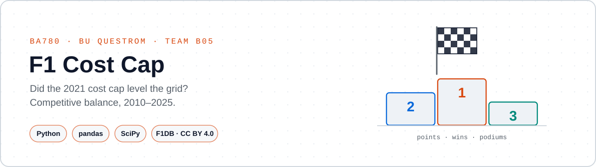
</picture>

<p align="center">
  <a href="https://colab.research.google.com/github/ashwinpr15/BA780-F1-Cost-Cap/blob/main/B05-F1-Cost-Cap.ipynb"></a>
  <a href="https://nbviewer.org/github/ashwinpr15/BA780-F1-Cost-Cap/blob/main/B05-F1-Cost-Cap.ipynb"></a>
  <a href="presentation/BA780-F1-Cost-Cap-Presentation.pdf"></a>
  
  <a href="https://github.com/f1db/f1db"></a>
</p>

**BA780-Introduction to Data Analytics · Boston University Questrom School of Business · Team B05**

Did the 2021 cost cap help more Formula 1 teams compete near the front? We compared constructor points, wins and podiums across 11 pre-cap seasons (2010–2020) and 5 post-cap seasons (2021–2025).

[At a glance](#at-a-glance) · [The grid](#the-grid-in-the-cost-cap-era) · [Key findings](#key-findings) · [All 15 charts](#all-15-charts) · [Presentation](#presentation) · [Method](#how-the-analysis-works) · [Run it](#run-it-yourself) · [Future work](#future-work) · [Open source](#built-on-open-source) · [Team](#team)

## How to use this

**Just read it:** open the notebook on GitHub, or [run it in Colab](https://colab.research.google.com/github/ashwinpr15/BA780-F1-Cost-Cap/blob/main/B05-F1-Cost-Cap.ipynb) with no install.

**Copy it to your own GitHub:**

1. Click **Fork** at the top right of this page.
2. Your copy opens under your account. It stays yours to edit.

**Run it on your computer:**

1. Download the code: `git clone https://github.com/ashwinpr15/BA780-F1-Cost-Cap.git`
2. Install the libraries: `pip install -r requirements.txt`
3. Open the notebook: `jupyter notebook B05-F1-Cost-Cap.ipynb`
4. Choose **Run → Run All Cells**.

Needs internet access, because the notebook downloads the F1 data.
## At a glance

| Measure | 2010–2020 | 2021–2025 | What it tells us |
|---|:---:|:---:|---|
| Top-two points share (CR2) | 54.72% | 52.14% | Down 2.58 pp, but inconclusive (Welch t = −1.215, p = 0.245) |
| Midfield share (P4–P7) | 24.71% | 26.16% | The middle of the grid gained a little |
| Big Three share (Ferrari, Mercedes, Red Bull) | 67.51% | 65.82% | Rises to **69.79%** if 2025 is excluded |
| Teams reaching a podium, per season | 5.18 | 6.00 | More teams on the podium |
| Teams winning a race, per season | 3.18 | 3.20 | Wins stayed concentrated |
| Effective number of equal-share teams | 4.83 | 4.92 | Whole-field evenness barely moved |

> **Bottom line:** a redistribution of success, with limited evidence of broad, lasting parity. Five post-cap seasons and overlapping rule changes mean we can't isolate the cap's effect.

## The grid in the cost-cap era

<table>
  <tr>
    <td width="50%">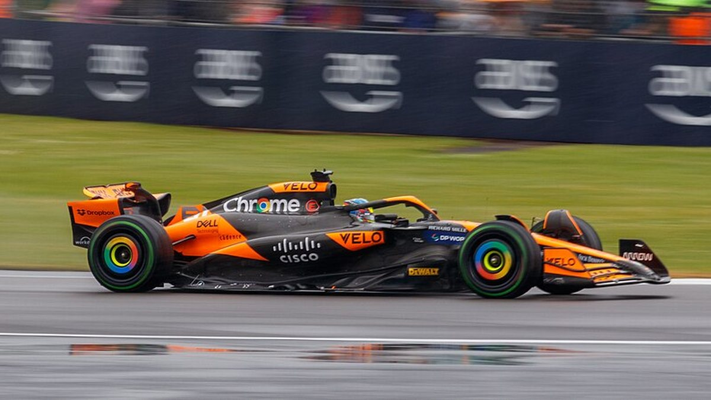<br><b>McLaren: the biggest gainer.</b> +7.48 pp of average points share after the cap.<br><sub>Photo: Jen Ross, <a href="https://creativecommons.org/licenses/by/2.0">CC BY 2.0</a>, cropped</sub></td>
    <td width="50%">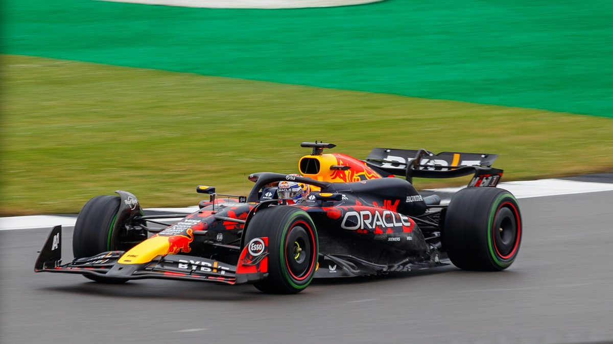<br><b>Red Bull: second-largest gain.</b> +4.60 pp among continuing teams.<br><sub>Photo: Jen Ross, <a href="https://creativecommons.org/licenses/by/2.0">CC BY 2.0</a>, cropped</sub></td>
  </tr>
  <tr>
    <td width="50%">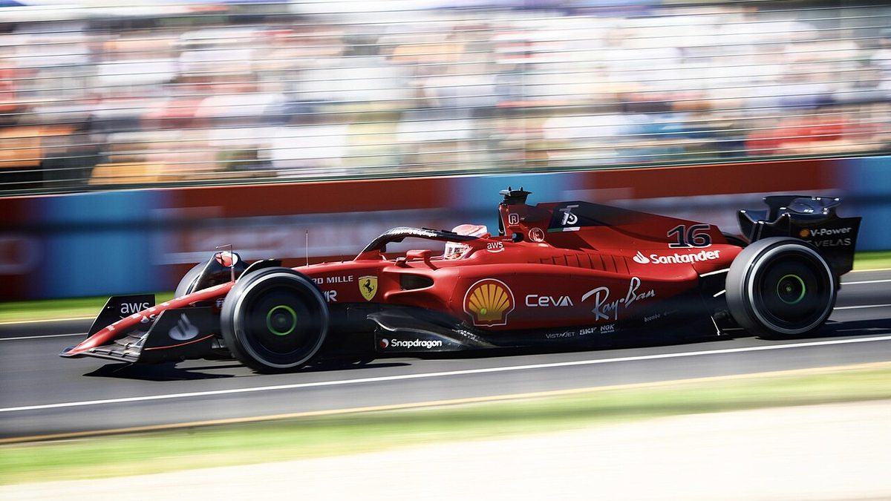<br><b>Ferrari: roughly level.</b> −0.67 pp.<br><sub>Photo: EJ Mina, <a href="https://creativecommons.org/licenses/by/4.0">CC BY 4.0</a>, cropped</sub></td>
    <td width="50%">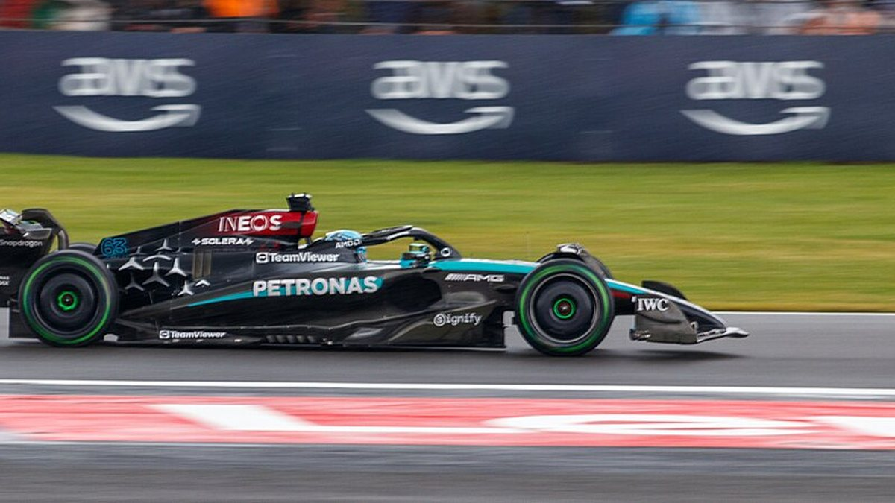<br><b>Mercedes: the largest drop.</b> −5.63 pp after its pre-cap run of titles.<br><sub>Photo: Jen Ross, <a href="https://creativecommons.org/licenses/by/2.0">CC BY 2.0</a>, cropped</sub></td>
  </tr>
</table>

<sub>Changes are average points share, 2021–2025 versus 2010–2020, from Chart 6. Full photo credits are in [CREDITS.md](CREDITS.md).</sub>

## Key findings

### 1. The top two took a slightly smaller share, but the test is inconclusive


The top two constructors averaged **54.72%** of points before the cap and **52.14%** after it. The Welch test is inconclusive (**t = −1.215, p = 0.245**), and comparing against the shorter 2014–2020 baseline changes the result, so the comparison period matters.

### 2. The Big Three result depends on one season


Ferrari, Mercedes and Red Bull averaged **67.51%** before the cap and **65.82%** after it. Excluding 2025 raises the post-cap average to **69.79%**, above the pre-cap level. Era averages alone would hide that reversal.

### 3. Gains went to a few teams, and wins stayed concentrated

<table>
  <tr>
    <td width="50%">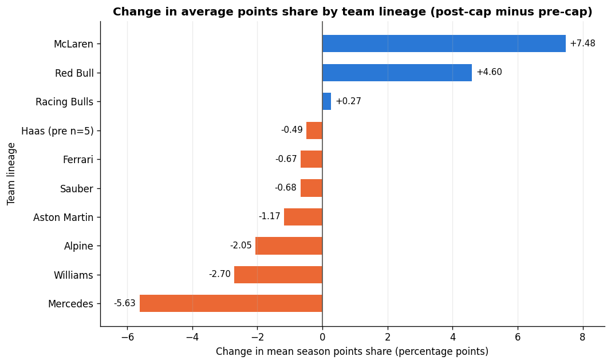<br><sub>Chart 6: McLaren and Red Bull gained the most; Mercedes, Williams and Alpine lost share.</sub></td>
    <td width="50%">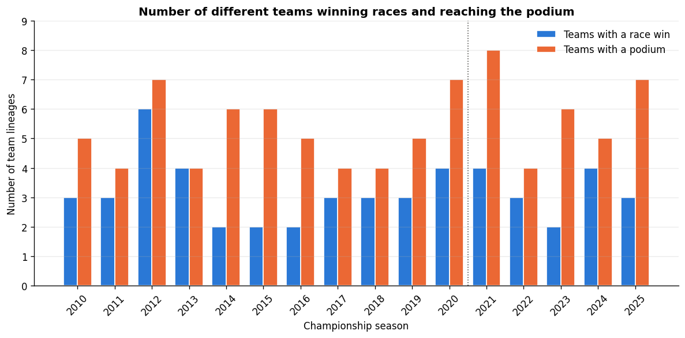<br><sub>Chart 12: more teams reached the podium (5.18 → 6.00), but race winners barely changed (3.18 → 3.20).</sub></td>
  </tr>
</table>

### 4. Why the cap's effect can't be isolated

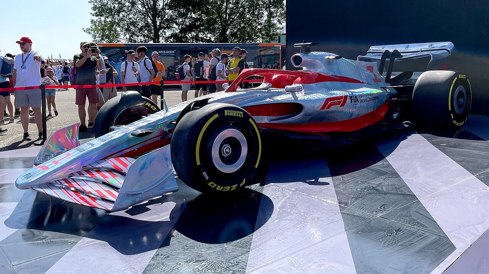

<sub>The 2022-regulation car shown at the 2021 British Grand Prix. Photo: Jen Ross, <a href="https://creativecommons.org/licenses/by/2.0">CC BY 2.0</a>, cropped.</sub>

The cost cap arrived in 2021, just before the biggest technical reset in decades: new ground-effect cars in 2022, plus aerodynamic testing restrictions. Driver moves, past investment, scoring changes and calendar changes also shift results. Points share measures sporting outcomes, not budgets or car speed, and the supporting tests are exploratory and not adjusted for multiple comparisons.

## All 15 charts

<details>
<summary><b>Open the full chart gallery</b> (exported from the saved notebook)</summary>
<br>

| | | |
|:---:|:---:|:---:|
| [](figures/01-top-two-points-share.png)<br>**1** Top-two points share | [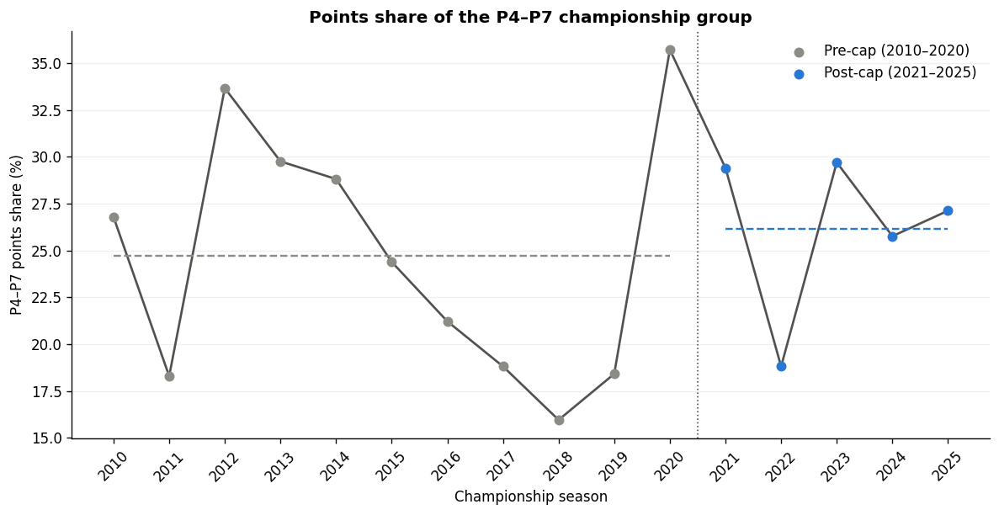](figures/02-midfield-points-share.png)<br>**2** Midfield points share | [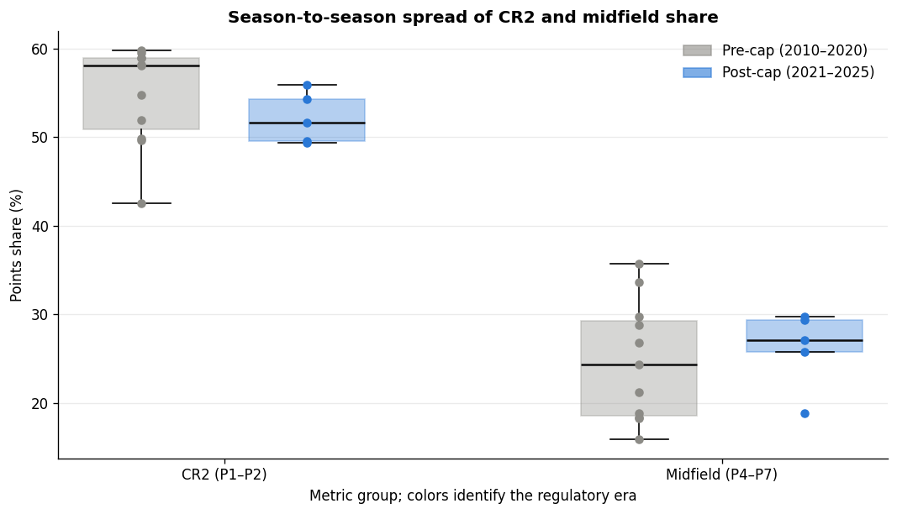](figures/03-variation-between-seasons.png)<br>**3** Variation between seasons |
| [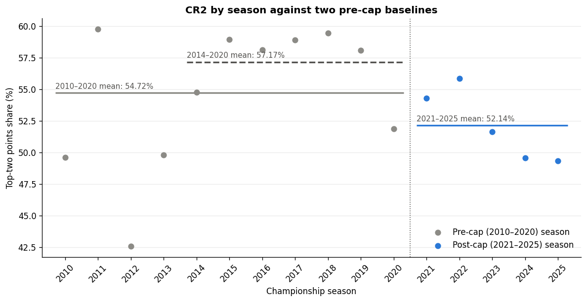](figures/04-two-pre-cap-baselines.png)<br>**4** Two pre-cap baselines | [](figures/05-the-influence-of-2025.png)<br>**5** The influence of 2025 | [](figures/06-gains-and-losses-by-team.png)<br>**6** Gains and losses by team |
| [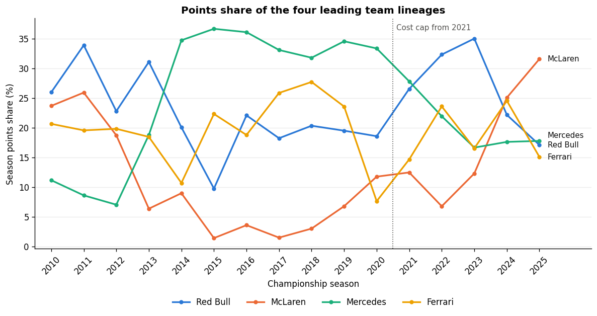](figures/07-timing-of-the-leading-teams-results.png)<br>**7** Timing of the leading teams' results | [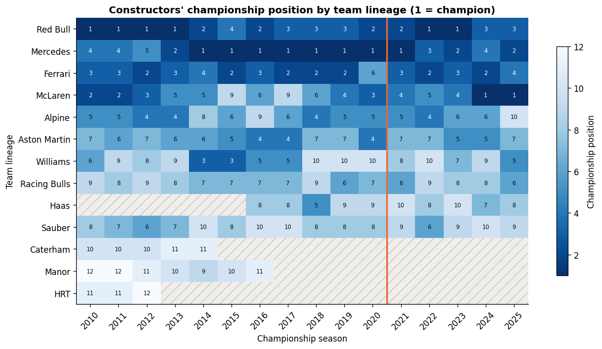](figures/08-championship-positions-across-names.png)<br>**8** Championship positions across names | [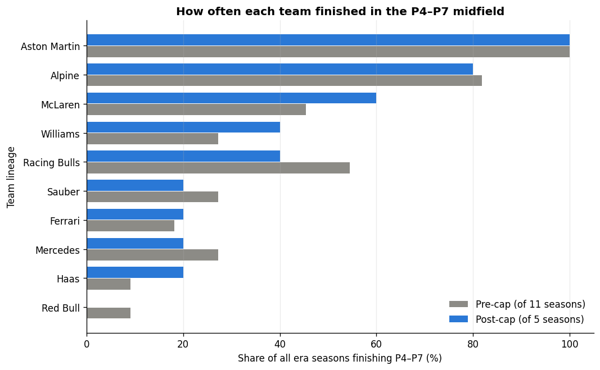](figures/09-who-filled-the-midfield.png)<br>**9** Who filled the midfield? |
| [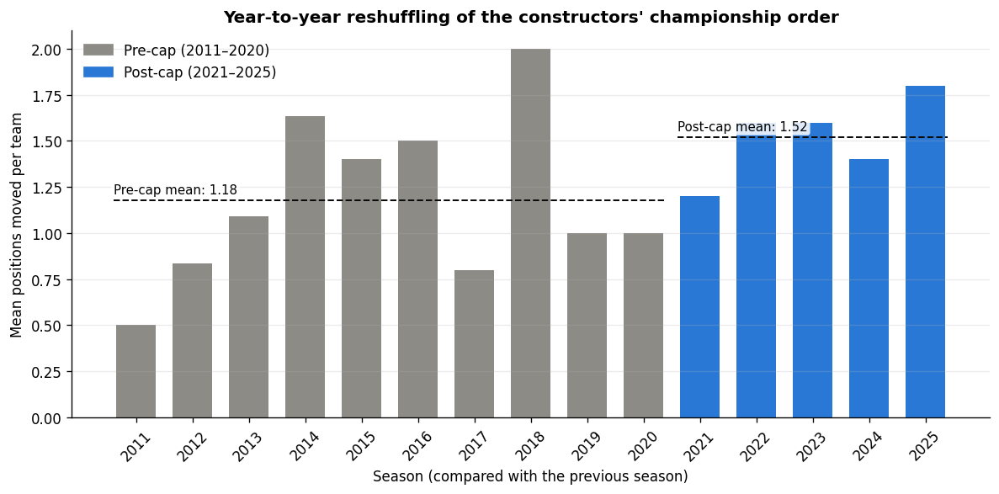](figures/10-year-to-year-rank-changes.png)<br>**10** Year-to-year rank changes | [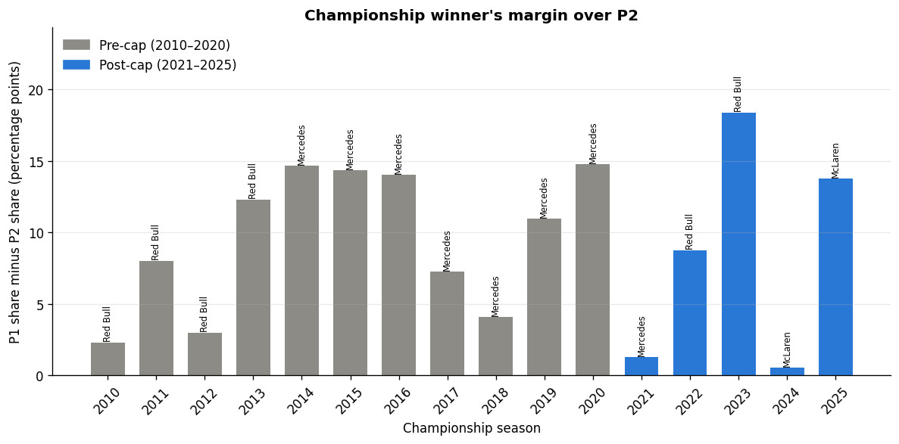](figures/11-the-championship-winning-margin.png)<br>**11** Championship winning margin | [](figures/12-teams-reaching-wins-and-podiums.png)<br>**12** Teams reaching wins and podiums |
| [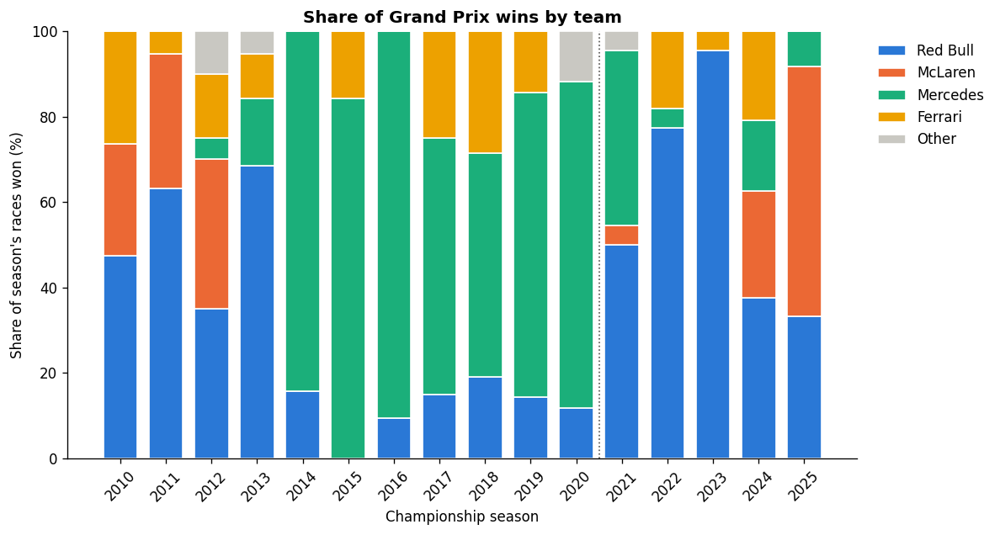](figures/13-distribution-of-race-wins.png)<br>**13** Distribution of race wins | [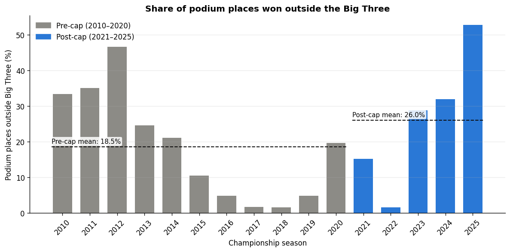](figures/14-podiums-outside-the-big-three.png)<br>**14** Podiums outside the Big Three | [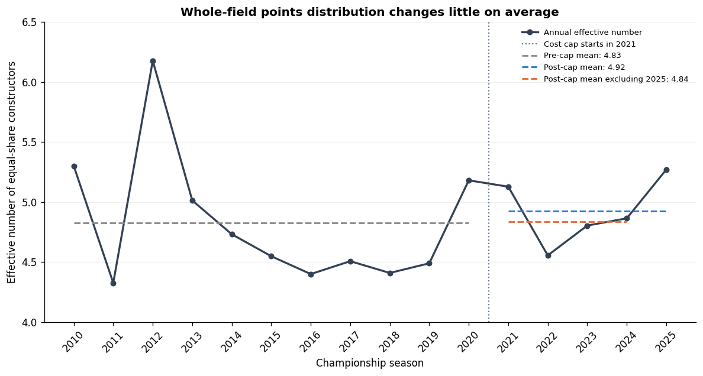](figures/15-evenness-across-the-whole-field.png)<br>**15** Evenness across the whole field |

</details>

## Presentation

**[Open the slides as a PDF](presentation/BA780-F1-Cost-Cap-Presentation.pdf)** (10 slides, 1.4 MB, opens in the browser). The original PowerPoint is in [`presentation/`](presentation/BA780-F1-Cost-Cap-Presentation.pptx) to download.

<table>
  <tr>
    <td width="50%">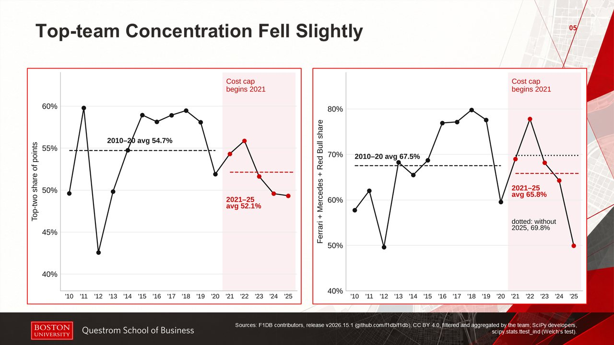</td>
    <td width="50%">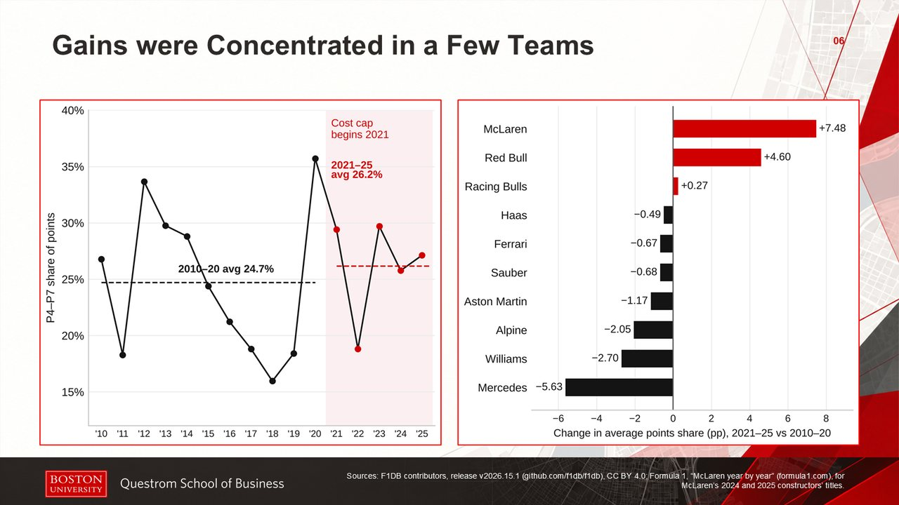</td>
  </tr>
  <tr>
    <td width="50%">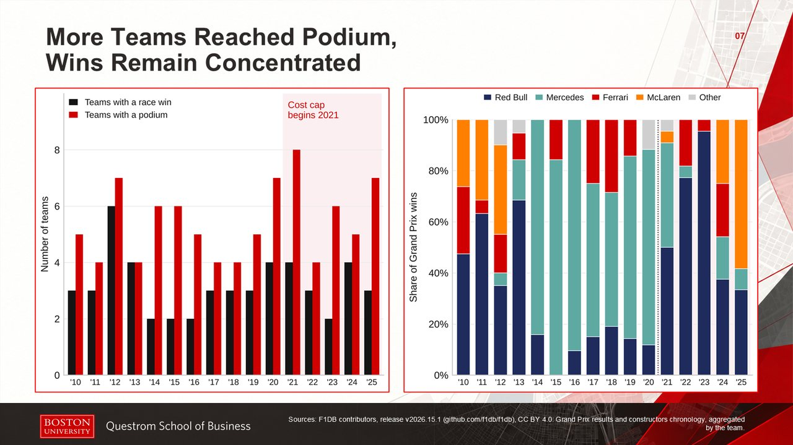</td>
    <td width="50%">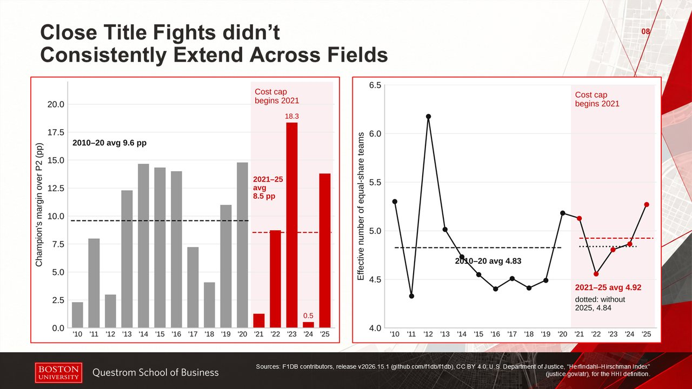</td>
  </tr>
</table>

### What we recommended

| Stakeholder | Action | Evidence |
|---|---|---|
| **FIA and F1** | Review several balance measures, both baselines, and results with and without the latest season before changing financial rules | CR2 −2.58 pp (p = 0.245); the Big Three result reverses without 2025 |
| **Constructors** | Set targets against relevant improving peers | McLaren +7.48 pp; Williams −2.70 and Alpine −2.05 |
| **Sponsors** | Shortlist emerging contenders and agree performance conditions | Podium teams 5.18 → 6.00 per season; outside-Big-Three podium share 19.35% without 2025 vs 26.04% with it |
| **Broadcasters** | Plan for both close and dominant seasons | Post-cap title margins range from 0.53 pp (2024) to 18.35 pp (2023) |

## How the analysis works

1. **Download a fixed data release.** The notebook retrieves the F1DB CSV archive for `v2026.15.1` and checks its SHA-256 against GitHub metadata.
2. **Check and join the tables.** It audits missing values and duplicates, joins constructors to standings, and links race results to the race calendar. It documents team name changes and the unusual 2018 Force India entries.
3. **Calculate points shares.** Each constructor's points are divided by the season's total points and multiplied by 100. Annual shares must total 100% within floating-point tolerance. Official championship positions determine the ranked groups.
4. **Compare the periods.** The main windows are 2010–2020 (11 seasons) and 2021–2025 (5 seasons). Every season has equal weight. Extra comparisons check the baseline and the influence of individual years.
5. **Explain the results.** Descriptive statistics, exploratory Welch tests and 15 charts of points concentration, team performance, wins and podiums. No machine learning or forecasting.

**Source:** [F1DB](https://github.com/f1db/f1db), release [`v2026.15.1`](https://github.com/f1db/f1db/releases/tag/v2026.15.1).

| CSV | Use |
|---|---|
| `f1db-constructors.csv` | Constructor IDs and names |
| `f1db-seasons-constructor-standings.csv` | Final positions and points |
| `f1db-seasons.csv` | Season lookup |
| `f1db-races.csv` | Race IDs and season years |
| `f1db-races-race-results.csv` | Race finishes, wins and podiums |

## Run it yourself

| Option | How |
|---|---|
| **Read only** | [Open on GitHub](B05-F1-Cost-Cap.ipynb) or on [nbviewer](https://nbviewer.org/github/ashwinpr15/BA780-F1-Cost-Cap/blob/main/B05-F1-Cost-Cap.ipynb) if GitHub's preview is slow |
| **Colab** | [Open in Colab](https://colab.research.google.com/github/ashwinpr15/BA780-F1-Cost-Cap/blob/main/B05-F1-Cost-Cap.ipynb), then **Runtime → Run all** |
| **Locally** | See below |

```sh
python -m venv .venv
# Windows: .venv\Scripts\activate    macOS/Linux: source .venv/bin/activate
pip install -r requirements.txt
jupyter notebook B05-F1-Cost-Cap.ipynb
```

Internet access is needed for the F1DB download; the data is held in memory, and nothing is written to disk. Keep `RELEASE_TAG_OVERRIDE = "v2026.15.1"` to use the same snapshot. The analysis ends in 2025 and excludes the incomplete 2026 season.

> **Reproducibility check (October 2026):** all 25 code cells run from a fresh download on Python 3.13 with pandas 3.0, NumPy 2.5, Matplotlib 3.11 and SciPy 1.18, and reproduce every number on this page.

## Future work

Our notebook ends with two next steps: add completed seasons and public spending disclosures, and combine results with audience data before valuing sponsorships. Beyond that, these extensions would sharpen the answer:

- [ ] **More seasons, new rules.** Add 2026 and later seasons as they finish. 2026 brings new power-unit and chassis regulations, a second natural test of balance under the cap.
- [ ] **Follow the money.** Link results to public spending evidence, such as the FIA's annual cost-cap compliance reports and teams' published company accounts, so "points per dollar" can be compared before and after the cap.
- [ ] **Measure car pace, not just points.** Use [FastF1](https://github.com/theOehrly/Fast-F1) timing data to track the qualifying gap between the fastest and slowest cars, which is less affected by scoring rules and reliability luck.
- [ ] **Stronger statistics.** Bootstrap confidence intervals, corrections for multiple comparisons, and an interrupted time-series model that allows for season-to-season dependence.
- [ ] **More balance measures.** Herfindahl–Hirschman and Gini indices on points, plus a driver-level view alongside constructors.
- [ ] **An interactive dashboard.** A [Streamlit](https://github.com/streamlit/streamlit) or Power BI view with season sliders and team filters, refreshed automatically by GitHub Actions when F1DB publishes a new release.
- [ ] **Commercial lens.** Join results with audience and sponsorship-exposure data, as the team recommended, to test whether closer racing changes commercial value.

## Built on open source

| Project | Role here | License |
|---|---|---|
| [F1DB](https://github.com/f1db/f1db) | Source data (release `v2026.15.1`) | CC BY 4.0 |
| [pandas](https://github.com/pandas-dev/pandas) | Tables, joins and aggregation | BSD-3-Clause |
| [NumPy](https://github.com/numpy/numpy) | Numerical work | BSD-3-Clause |
| [Matplotlib](https://github.com/matplotlib/matplotlib) | All 15 charts | Matplotlib License (PSF-based) |
| [SciPy](https://github.com/scipy/scipy) | Welch t-tests | BSD-3-Clause |
| [Jupyter](https://github.com/jupyter/notebook) / IPython | Notebook report | BSD-3-Clause |

**Useful for the future work above:** [FastF1](https://github.com/theOehrly/Fast-F1) (MIT) for timing and telemetry, the [Jolpica F1 API](https://github.com/jolpica/jolpica-f1) (Apache-2.0, an open successor to the Ergast API) for historical results, and [Streamlit](https://github.com/streamlit/streamlit) (Apache-2.0) or [Plotly](https://github.com/plotly/plotly.py) (MIT) for interactive charts.

## Repository structure

```
BA780-F1-Cost-Cap/
├── B05-F1-Cost-Cap.ipynb        # full report: code, saved outputs, 15 charts
├── requirements.txt             # libraries for a local run
├── figures/                     # the 15 charts, exported from the notebook
├── presentation/
│   ├── BA780-F1-Cost-Cap-Presentation.pdf
│   ├── BA780-F1-Cost-Cap-Presentation.pptx
│   └── slides/                  # previews of the chart slides
├── assets/
│   ├── banner-dark.svg, banner-light.svg
│   └── photos/                  # openly licensed photos, see CREDITS.md
└── CREDITS.md                   # data, photo and software attribution
```

## Team

**Team B05:** Adrian Marcell, Ashwin Pillanda Ravindra, Jenniffer Hierro Cruz and Saleha Hassan Alvi.

## Credits

- **Data:** F1DB contributors, [CC BY 4.0](https://github.com/f1db/f1db/blob/main/LICENSE). We filter, join and aggregate the source tables.
- **Photos:** openly licensed via Wikimedia Commons, cropped and resized; authors and licenses are in [CREDITS.md](CREDITS.md).
- **Presentation:** includes third-party imagery whose rights remain with its owners. The slide previews above show only the team's own charts.
- **References and generative AI disclosure:** sections 12 and 13 of the notebook.

Formula 1, F1 and team names are trademarks of their owners. This is an academic project, not affiliated with or endorsed by Formula 1, the FIA or any team.
