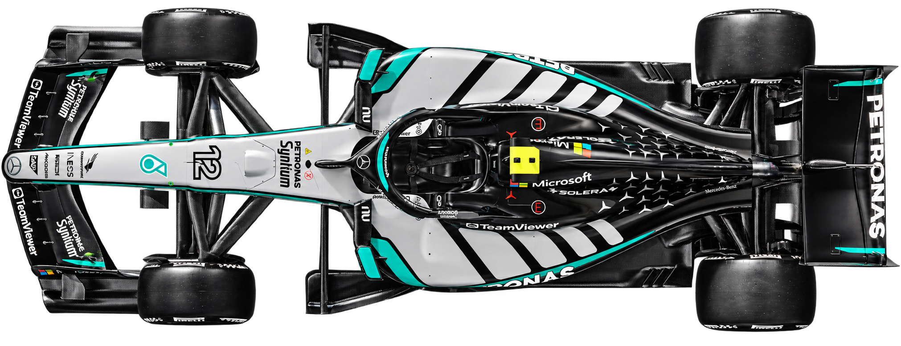
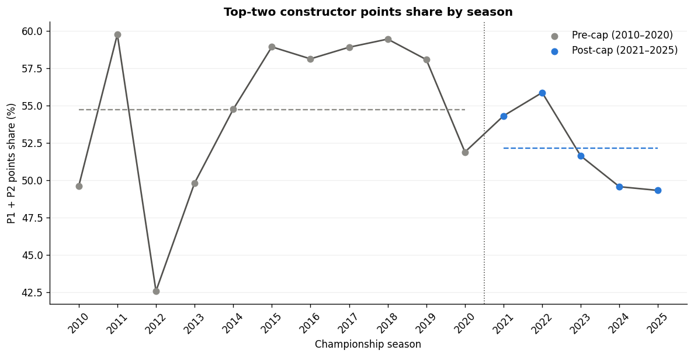
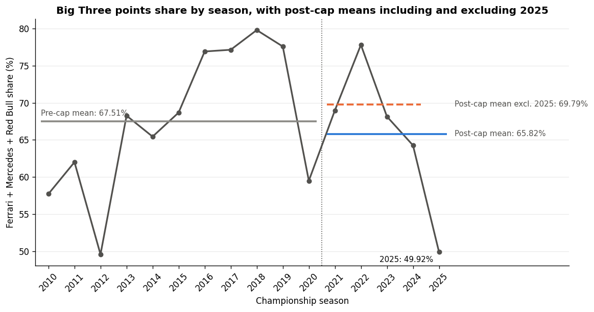

# Formula 1 Cost Cap and Competitive Balance

**BA780 - Introduction to Data Analytics | Boston University Questrom School of Business | Team B05**

Did the 2021 cost cap help more F1 teams compete near the front? We looked at championship points, wins, and podiums from 2010–2025 to see what changed.

## Project files

| File | What it contains |
|---|---|
| [B05-F1-Cost-Cap.ipynb](B05-F1-Cost-Cap.ipynb) | Full report, Python code, saved outputs, and all 15 charts |
| [BA780-F1-Cost-Cap-Presentation.pptx](BA780-F1-Cost-Cap-Presentation.pptx) | Our final team presentation |
| PNG images | Two charts exported from the saved notebook and the car image used above |

## Two findings to start with

### The top two took a slightly smaller share of points

The top two constructors averaged **54.72%** of the points before the cap and **52.14%** after it, a decline of **2.58 percentage points**. The main Welch test was inconclusive (**t = −1.215, p = 0.245**). Comparing against the shorter 2014–2020 baseline changes the result, so the comparison period matters.

### The Big Three result depends on 2025

Ferrari, Mercedes, and Red Bull averaged **67.51%** before the cap and **65.82%** after it. Excluding 2025 raises the post-cap average to **69.79%**, above the pre-cap figure. Looking only at the two era averages would miss that difference.

## How the analysis works

1. **Download a fixed data release.** The notebook retrieves the F1DB CSV archive for `v2026.15.1` and checks its SHA-256 against GitHub metadata.
2. **Check and join the tables.** It audits missing values and duplicates, joins constructors to standings, and links race results to the race calendar. It documents team name changes and the unusual 2018 Force India entries.
3. **Calculate points shares.** Each constructor’s points are divided by the season’s total points and multiplied by 100. Annual shares must total 100% within floating-point tolerance. Official championship positions determine the ranked groups.
4. **Compare the periods.** The main windows are 2010–2020 (11 seasons) and 2021–2025 (5 seasons). Every season has equal weight. Additional comparisons check the baseline and the influence of individual years.
5. **Explain the results.** The report combines descriptive statistics, exploratory Welch tests, and charts of points concentration, team performance, wins, and podiums. It uses no machine learning or forecasting.

Points share measures sporting performance. It does not measure revenue or team spending. The small post-cap sample and overlapping changes, including the 2022 aerodynamic rules and aerodynamic testing restrictions, prevent us from isolating the cost cap’s effect.

## Data and tools

**Source:** [F1DB](https://github.com/f1db/f1db), release [`v2026.15.1`](https://github.com/f1db/f1db/releases/tag/v2026.15.1).

| CSV | Use |
|---|---|
| `f1db-constructors.csv` | Constructor IDs and names |
| `f1db-seasons-constructor-standings.csv` | Final positions and points |
| `f1db-seasons.csv` | Season lookup |
| `f1db-races.csv` | Race IDs and season years |
| `f1db-races-race-results.csv` | Race finishes, wins, and podiums |

**Python libraries:** pandas for tables and joins, NumPy for numerical work, Matplotlib for charts, and SciPy for Welch tests. Python’s standard libraries handle downloads, ZIP files, and checksums.

## Open or run the notebook

- **Read it on GitHub:** [open the notebook](B05-F1-Cost-Cap.ipynb) to view the saved report and outputs.
- **Run it in Colab:** [open in Google Colab](https://colab.research.google.com/github/ashwinpr15/BA780-F1-Cost-Cap/blob/main/B05-F1-Cost-Cap.ipynb), connect to a runtime, then choose **Runtime → Run all**. Internet access is required for the F1DB download.
- **Run it locally:** use Jupyter with pandas, NumPy, Matplotlib, SciPy, and IPython installed. Run the cells from top to bottom.

Keep `RELEASE_TAG_OVERRIDE = "v2026.15.1"` to use the same source snapshot. The analysis ends in 2025 and excludes the incomplete 2026 season.

## Team

Adrian Marcell, Ashwin Pillanda Ravindra, Jenniffer Hierro Cruz, and Saleha Hassan Alvi.

## Attribution

F1DB contributors provide the data under [CC BY 4.0](https://github.com/f1db/f1db/blob/main/LICENSE). Our notebook filters, joins, and aggregates the source tables. The two charts above come from its saved outputs. The car illustration comes from our supplied presentation and is decorative. Image and brand rights remain with their respective owners. Detailed references and the team’s assistance disclosure remain in the notebook.

